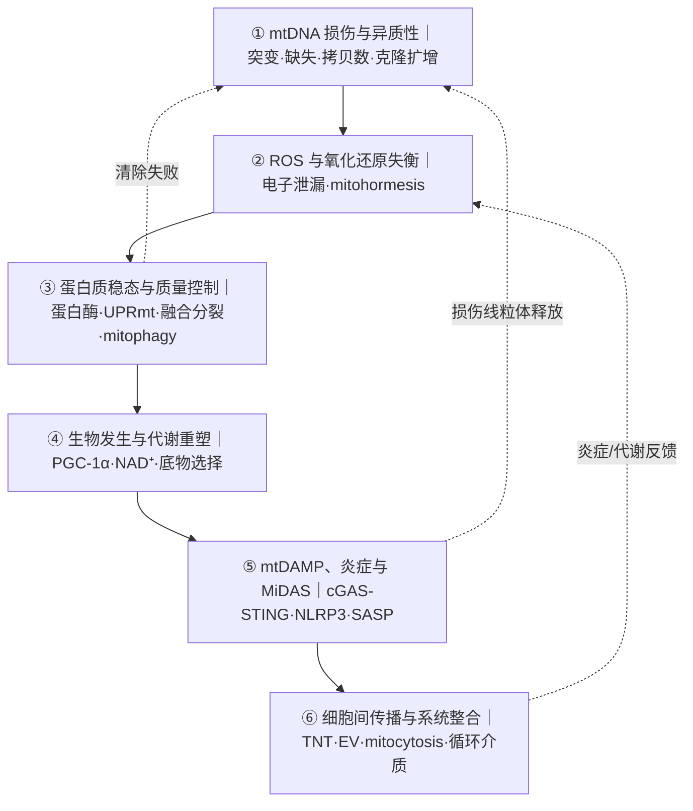
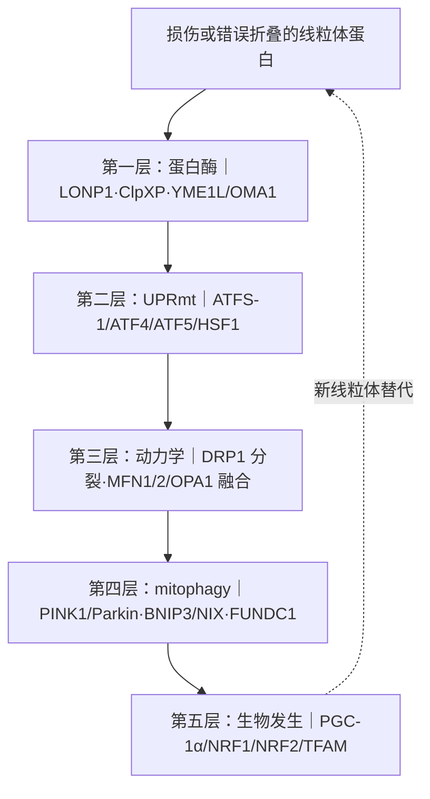
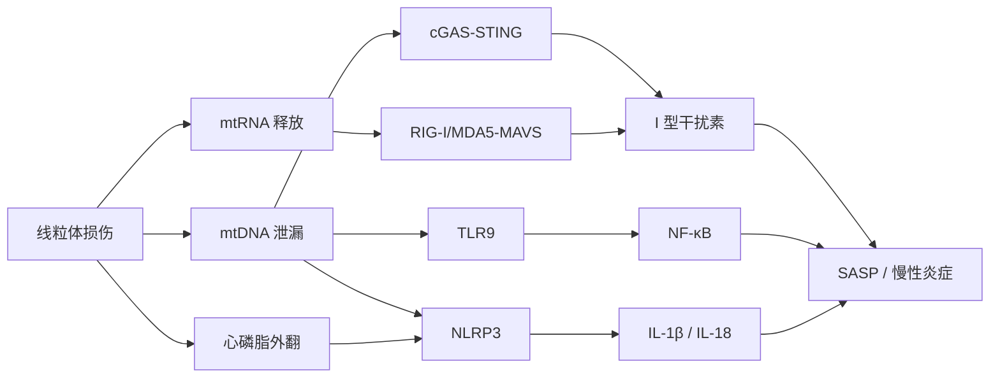
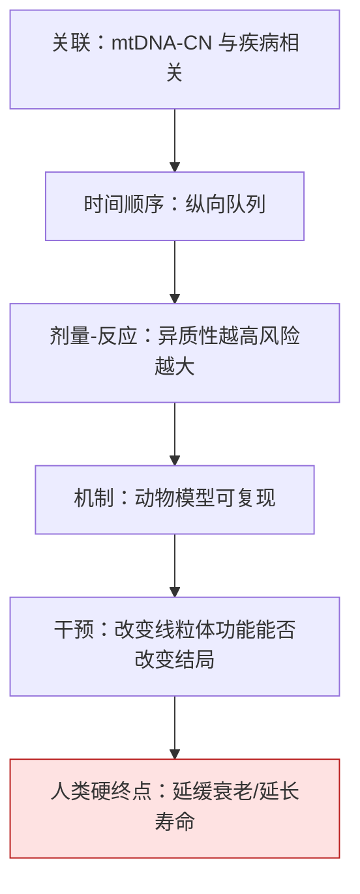
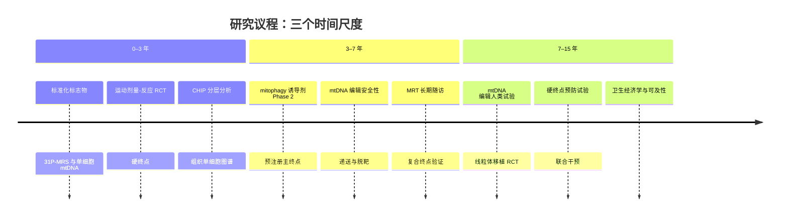

# 线粒体衰老：机制、因果与影响面

**调研报告 · 2026-10-28**

> 本报告是《衰老机制调研》的专题深化版，聚焦线粒体。所有非显然论断都标注证据等级；文末附“主动降级清单”“研究议程”与“判断边界”。
>
> 证据等级：**A** 强（多物种、多项独立研究、人类 RCT 或系统综述一致）；**B** 中（多项研究但存在物种差异、观察性设计或单项高质量 RCT）；**C** 有限（单一模型、小样本、初步试验、因果未定）；**D** 推测/争议（假说、未重复、结论冲突、主要体外）。

---

## 摘要

线粒体衰老不是“线粒体坏了”这一句话，而是**六层维护机制的渐进失效**：mtDNA 损伤与异质性、ROS 与氧化还原失衡、蛋白质稳态与质量控制、生物发生与代谢重塑、mtDAMP 炎症信号、细胞间传播与系统整合。六层之间互相耦合，任何单层解释都不足以概括。

过去五年最重要的进展不是“找到了线粒体衰老的开关”，而是**把不同证据放回了它们该在的位置**：

- mtDNA mutator 小鼠证明 mtDNA 突变**可以**驱动衰老表型，但它的突变负荷远高于自然衰老，不能直接外推；
- 人类血液 mtDNA 异质性在很大程度上是**克隆性造血（CHIP）**的读数，不是实体组织线粒体衰老的直接指标；
- 组织内单细胞水平的 cryptic mtDNA 突变是更有希望的“组织衰老时钟”，但目前仍是研究工具；
- mtDNA-CN 是风险标志物，不是因果驱动因素，也不是“线粒体年龄”；
- 没有任何线粒体靶向干预被证明能在健康人类中延缓衰老或延长寿命；
- 证据最强的干预（运动）机制最不特异，机制最特异的干预（mtDNA 编辑、线粒体移植）人类证据最弱。

这份报告的核心判断是：**线粒体功能障碍是衰老网络中的核心节点与放大器，不是单一总开关。** 影响面评估必须同时看证据强度、效应量、年龄窗口与可干预性，不能用一个标签统一处理所有器官。

---

## 0 十条判断

| # | 判断 | 证据 | 含义 |
|---|---|---|---|
| 1 | 线粒体衰老是多层维护失败，不是单一通路 | B | 六层机制带反馈，单层归因会在因果推断上失败 |
| 2 | mtDNA 突变可以驱动衰老表型 | B | mutator 小鼠是 proof-of-principle，不是正常衰老模型 |
| 3 | 人类血液 mtDNA 异质性主要是 CHIP 标志 | B | 抽血测到的“线粒体年龄”不能代表实体组织 |
| 4 | 组织单细胞 cryptic 突变是更强的组织衰老候选 | B | 研究工具，尚未临床可用 |
| 5 | mtDNA-CN 是风险标志物，不是因果因素 | B | 观察性关联受血细胞组成与炎症混杂；MR 多为 null |
| 6 | 影响面器官差异极大 | B | 心脏、脑、骨骼肌、免疫最强；皮肤、肺最弱 |
| 7 | 年龄依赖性强不等于可干预性高 | B | 眼、耳、骨就是典型反例 |
| 8 | 没有单一标志物能被称为“线粒体年龄” | B | 31P-MRS 最好，但只能测骨骼肌 |
| 9 | 运动是唯一 A 级干预 | A | VO2max 改善，但 citrate synthase 不是敏感终点 |
| 10 | 没有任何线粒体干预被证明能延缓健康人类衰老 | B | 机制合理、动物有效、替代终点改善、硬终点获益是四件事 |

---

## 1 定义与边界：什么在衰老？

### 1.1 线粒体的六类功能

讨论“线粒体衰老”之前，先明确我们说的是哪一类功能。线粒体不只是“细胞的发电厂”：

| 功能 | 内容 | 衰老时的变化 | 证据 |
|---|---|---|---|
| 能量转换 | OXPHOS、TCA 循环、脂肪酸氧化 | 呼吸能力下降、ATP 合成下降 | B |
| 代谢枢纽 | 氨基酸、脂质、铁硫簇、血红素、类固醇合成 | 底物选择改变、酰基肉碱积累 | B |
| 钙缓冲 | 摄取与释放 Ca²⁺，调节胞质钙信号 | 缓冲能力下降、mPTP 敏感性增加 | B |
| ROS 信号 | 电子传递链泄漏、逆向电子传递、信号转导 | ROS 产生增加、信号特异性下降 | B |
| 生物合成 | 铁硫簇、血红素、核苷酸、脂质 | 合成能力下降 | B |
| 凋亡 | 细胞色素 c 释放、凋亡体组装 | 凋亡阈值改变 | B |

这六类功能不是并列的：能量转换与 ROS 产生共享电子传递链，钙缓冲与凋亡共享 mPTP，代谢枢纽与生物合成共享 TCA 循环中间产物。**一个节点的损伤会通过共享底物与共享膜电位扩散到其他功能。**

### 1.2 三个分析层次

| 层次 | 对象 | 典型测量 | 典型证据 |
|---|---|---|---|
| 分子损伤 | mtDNA 突变/缺失、氧化修饰、蛋白质损伤 | 测序、质谱、氧化标志 | 组织活检、单细胞 |
| 细胞器功能障碍 | 呼吸、膜电位、动力学、mitophagy、mPTP | Seahorse、JC-1、成像 | 细胞与动物模型 |
| 系统后果 | mtDAMP、炎症、细胞间传播、器官功能 | 细胞因子、cf-mtDNA、器官表型 | 人群队列、临床试验 |

把三个层次混在一起，是“线粒体衰老”叙事最常见的错误。例如，血液 mtDNA-CN 是分子/细胞层次的指标，却被用来推断器官功能；mtDNA 编辑是分子层次的工具，却被用来承诺系统性的抗衰老。

### 1.3 三条边界

**第一，线粒体衰老不等于线粒体病。** 线粒体病通常由高异质性致病突变或核基因缺陷引起，发病早、表型重；衰老相关的线粒体变化是低比例、多基因、渐进的。把两者混为一谈，会高估致病突变在正常衰老中的普遍性，也会低估衰老的异质性。

**第二，血液指标不等于组织衰老。** 血液 mtDNA 异质性主要是 CHIP 的读数；mtDNA-CN 受血细胞组成、炎症、吸烟、BMI 影响。用血液指标代表心脏、脑、肌肉的线粒体状态，是范畴错误。

**第三，不是所有器官同步衰老。** 心肌与神经元几乎完全依赖 OXPHOS，肾小管与视网膜 RPE 对线粒体损伤特别敏感；皮肤成纤维细胞、肺泡上皮的证据则弱得多。影响面必须逐器官评估。

---

## 2 六层机制地图

**图 1 · 六层机制地图**：六层不是六个独立病因，而是一个带反馈的网络。

### 2.1 mtDNA 不稳定性与异质性

**基本信息。** 人类 mtDNA 是约 16.6 kb 的环状双链 DNA，编码 13 个 OXPHOS 蛋白、22 个 tRNA、2 个 rRNA。每个细胞有数百到数千个拷贝，呈母系遗传。mtDNA 靠近电子传递链，理论上是氧化损伤的靶点；但 2026 年的大队列研究给出了一个更复杂的图景：**血液 mtDNA 突变的谱型与复制错误一致，而不是氧化损伤。**

**四个关键概念。**

| 概念 | 定义 | 为什么重要 |
|---|---|---|
| 异质性 | 同一细胞内突变型与野生型 mtDNA 共存的比例 | 决定表型的关键变量，不是“有或无” |
| 阈值效应 | 突变比例超过组织特异阈值后才出现功能缺陷 | 不同组织阈值不同，脑、肌肉、心脏尤其敏感 |
| 瓶颈效应 | 卵母细胞发育中 mtDNA 拷贝数急剧减少再扩增 | 导致后代异质性比例随机漂变 |
| 克隆扩增 | 单个突变 mtDNA 分子被选择性复制 | 衰老组织中突变比例升高的主要机制之一 |

**2026 年 Nature 的血液图景。** 基于约 75 万人的研究显示：血液 mtDNA 单核苷酸变异随年龄积累，60 岁后急剧上升；大多数变异比例很低；正选择信号很弱；突变谱与复制错误一致；GWAS 命中 TERT、TCL1A、SMC4 等与克隆性造血相关的位点。**血液 mtDNA 异质性在很大程度上是 CHIP 的标志物**，而不是实体组织线粒体衰老的直接读数。

**2025 年单细胞图景。** 对 4 个物种、7 种组织、超过 14 万个细胞的分析显示：在异质性 ≥0.5% 时，bulk 测序只能检出约 9% 的突变；在异质性 <0.5% 时，约 91% 的突变只有单细胞测序才能发现，其中约 94% 是“单细胞独有”。这些 cryptic 突变在衰老的终末分化组织中占主导，且热量限制可以减缓其积累。**组织特异性、单细胞水平的 mtDNA 突变，是比血液异质性更有希望的“组织衰老时钟”**——但目前仍是研究工具。

**人类队列的死亡率信号。** 英国生物银行 194,871 人的分析显示，随着异质性变异数量增加，死亡风险逐步上升：1 个变异的 HR 约 1.03，2 个约 1.11，3 个约 1.18，4 个及以上约 1.49；无义变异的 HR 约 1.65（95% CI 0.99–2.70）。该分析包含 12,573 例死亡。**这是关联，不是因果；而且血液异质性与 CHIP 高度纠缠。**

**图 2 · 异质性与阈值：同一个突变，不同组织不同命运**

| 异质性水平 | 常见场景 | 功能后果 | 证据 |
|---|---|---|---|
| <10% | 大多数健康人血液 | 通常无表型 | B |
| 10–30% | 部分组织、部分线粒体病携带者 | 阈值边缘，应激时暴露 | B |
| 30–60% | MELAS/MERRF 等致病突变 | 组织特异缺陷 | A |
| >60–80% | 严重线粒体病 | 多系统受累 | A |

阈值不是固定数字：脑、肌肉、心脏对 OXPHOS 缺陷更敏感；肝脏、肾脏有一定代偿空间。**“突变比例”必须与“组织类型”和“功能终点”一起读。**

### 2.2 ROS、氧化还原与线粒体信号

**ROS 不是单纯的“坏分子”。** 线粒体 ROS 主要来自复合体 I 的逆向电子传递（RET）与复合体 III 的 Q 循环泄漏；NOX 家族、过氧化物酶体、内质网也贡献。生理浓度的 ROS 参与缺氧感应、免疫防御、干细胞分化、胰岛素信号；过量才导致脂质、蛋白质、DNA 氧化损伤。

**Mitohormesis（线粒体毒物兴奋效应）。** 低剂量线粒体应激（运动、热量限制、轻度复合体 I 抑制）可以诱导适应性反应：PGC-1α 上调、抗氧化酶上调、mitophagy 增强、蛋白酶体活性增加。这解释了为什么“清除所有 ROS”在人类中反复失败，而“适度应激”可能有益。**剂量决定方向，而不是分子本身决定好坏。**

**抗氧化剂失败的四个模式。**

| 失败模式 | 解释 | 例子 |
|---|---|---|
| 时机错误 | ROS 在早期信号中是有益的，晚期才有害 | 运动后立即大剂量抗氧化剂可能削弱适应 |
| 定位错误 | 自由基在特定微区产生，全身性抗氧化剂到不了靶点 | 线粒体基质 vs 胞质 vs 膜间隙 |
| 剂量错误 | 高剂量破坏 mitohormesis，甚至促氧化 | 维生素 E、β-胡萝卜素高剂量试验 |
| 终点错误 | 用“氧化标志下降”代替“临床结局改善” | 标志物改善但死亡率不变 |

**人类证据是明确的负面结论。** 维生素 E、β-胡萝卜素、MitoQ 等在大型随机试验中未显示健康获益，部分试验甚至增加风险（SELECT 试验中维生素 E 增加前列腺癌风险；CARET 试验中 β-胡萝卜素+维生素 A 增加肺癌风险）。**这是本报告最确定的负面结论之一，证据等级 A。**

### 2.3 蛋白质稳态与质量控制

线粒体质量控制（MQC）是一个五层漏斗：

**图 3 · 五层质量控制漏斗**：每一层都可能随年龄下降，但下降的幅度与组织特异性不同。

| 层级 | 关键分子 | 衰老时的变化 | 证据 |
|---|---|---|---|
| 蛋白酶 | LONP1、ClpXP、YME1L、OMA1 | 活性下降、底物积累 | B |
| UPRmt | ATFS-1（线虫）、ATF4/ATF5/HSF1（哺乳动物） | 响应减弱、慢性化 | B |
| 分裂/融合 | DRP1、MFF、FIS1、MFN1/2、OPA1 | 碎片化、融合不足 | B |
| Mitophagy | PINK1/Parkin、BNIP3/NIX、FUNDC1 | 效率下降、受体表达改变 | B |
| 生物发生 | PGC-1α、NRF1、NRF2、TFAM | 运动或应激诱导能力下降 | B |

**两个反直觉点。**

第一，**不是所有 mitophagy 都是好的**。过度清除线粒体会导致能量危机；在某些肿瘤细胞中，mitophagy 反而支持生存。把“增强 mitophagy”当作无条件正确的目标，是机制上的过度简化。

第二，**质量控制是有代价的**。蛋白酶与自噬消耗 ATP；在能量已经不足的衰老细胞中，强行激活质量控制可能加速死亡。这解释了为什么一些 mitophagy 诱导剂在动物中有效、在人类中效果不一致。

### 2.4 生物发生与代谢重塑

**PGC-1α 轴。** 运动、寒冷、热量限制通过 AMPK、SIRT1、CaMK 等激活 PGC-1α，进而激活 NRF1/NRF2 与 TFAM，促进线粒体生物发生与 mtDNA 复制。衰老组织中 PGC-1α 的诱导能力下降，但基线水平不一定低——这取决于组织与活动水平。

**NAD⁺ 的复杂性。** NAD⁺ 是 SIRT1、PARP、CD38 的底物，也是糖酵解与 TCA 循环的辅酶。衰老组织中 NAD⁺ 下降的机制包括：合成减少（NAMPT 下降）、消耗增加（PARP/CD38 激活）、炎症相关消耗。但 2026 年 Nature Metabolism 的研究测量全血 NAD⁺，发现它**不随年龄变化，也不随生活方式干预变化**；只有烟酰胺核糖（NR）补充能显著升高全血 NAD⁺。**这并不否定组织 NAD⁺ 在部分模型中下降，但说明“全血 NAD⁺ 缺乏”不是一个普遍事实。**

**底物选择的变化。** 衰老肌肉与心脏从脂肪酸氧化向糖酵解偏移，伴随酰基肉碱积累、线粒体膜通透性增加、ROS 产生增加。这种“代谢重编程”既可能是线粒体损伤的结果，也可能是代偿机制；方向性因组织与阶段而异。

| 代谢特征 | 年轻 | 衰老 | 证据 |
|---|---|---|---|
| 主要底物 | 脂肪酸氧化为主 | 糖酵解比例上升 | B |
| 酰基肉碱 | 低 | 升高 | B |
| 线粒体膜流动性 | 较高 | 下降（胆固醇/氧化脂质） | B |
| 生物发生诱导能力 | 强 | 减弱 | B |

### 2.5 mtDAMP、炎症与 MiDAS

**mtDAMP 是什么。** 线粒体来源的损伤相关分子模式（mtDAMP）包括：mtDNA、mtRNA、心磷脂、细胞色素 c、ATP、甲酰肽。它们在没有细菌感染的情况下可以激活先天免疫，造成“无菌性炎症”。

| mtDAMP | 受体/通路 | 输出 | 证据 |
|---|---|---|---|
| mtDNA | cGAS-STING、TLR9、NLRP3 | I 型干扰素、IL-1β、NF-κB | B |
| mtRNA | RIG-I/MDA5-MAVS | I 型干扰素 | B |
| 心磷脂 | NLRP3、TLR2 | IL-1β、炎症 | B |
| 细胞色素 c | 凋亡体、TLR | 凋亡、炎症 | B |
| ATP | P2X7 | NLRP3 激活、IL-1β | B |
| 甲酰肽 | FPR1 | 中性粒细胞趋化 | B |

**图 4 · mtDAMP 信号通路**：线粒体损伤通过多条先天免疫通路转化为炎症表型。

**MiDAS。** 线粒体功能障碍相关衰老（mitochondrial dysfunction-associated senescence）是一种特殊的细胞衰老状态：它与 DNA 损伤性衰老共享部分特征（p53/p21 激活、细胞周期停滞），但 SASP 组成不同，且依赖 AMPK 与 p53。MiDAS 把“线粒体损伤”与“衰老细胞积累”连接起来，是解释“线粒体衰老如何扩散到全身”的关键机制。证据等级 B。

### 2.6 细胞间传播与系统整合

线粒体损伤可以从一个细胞传播到另一个细胞，至少有四条路径：

| 路径 | 机制 | 例子 | 证据 |
|---|---|---|---|
| 隧道纳米管（TNT） | 细胞间直接连接，转移线粒体/囊泡 | 间充质干细胞救援受损上皮 | B |
| 细胞外囊泡（EV） | 包装 mtDNA、mtRNA、蛋白 | 炎症扩散、抗原呈递 | B |
| Mitocytosis | 线粒体通过迁移体排出 | 中性粒细胞、干细胞 | C |
| 细胞融合 | 合胞体或异常融合 | 肌纤维、肿瘤微环境 | C |

**系统整合。** 器官之间通过循环介质耦合：肌肉分泌 irisin、FGF21；脂肪分泌 adiponectin、GDF15；免疫细胞分泌 IL-6、TNF-α；肝脏分泌 FGF21；脑通过交感神经调节代谢。线粒体功能障碍可以改变这些介质的分泌，进而影响远端器官。**这是“多病共存”的一个可检验解释，但因果链尚未证明。** 证据等级 B。

---

## 3 因果证据阶梯

因果推断的核心问题不是“有没有关联”，而是“**哪一类证据能支持哪一级结论**”。线粒体衰老领域最常见的错误，是把“动物模型中的充分性”当成“人类衰老中的必要性”，或者把“观察性关联”当成“因果驱动”。

| 证据类型 | 代表研究 | 能支持 | 不能支持 | 等级 |
|---|---|---|---|---|
| mtDNA mutator 小鼠 | Polg D257A | mtDNA 突变可以驱动衰老表型 | 正常衰老由同等负荷的 mtDNA 突变驱动 | B |
| 人类线粒体病遗传学 | m.3243A>G、LHON、大片段缺失 | 线粒体缺陷可以导致组织特异疾病 | 常见衰老由高异质性致病突变驱动 | A（疾病）/C（衰老） |
| 血液 mtDNA 异质性 | UK Biobank、2026 Nature | 与死亡/疾病关联；CHIP 标志 | 实体组织线粒体衰老的直接读数 | B |
| 组织单细胞突变 | 2025 Nat Commun | 衰老组织普遍存在 cryptic 突变 | 因果性、临床可用性 | B |
| mtDNA-CN + MR | 大队列 + 孟德尔随机化 | 风险分层 | 因果驱动、组织特异性 | B |
| 干预试验 | 运动、elamipretide、移植 | 某些终点可改变 | 延缓衰老、延长寿命 | A/B/C |
| 线粒体移植 | Phase 1 卒中 | 安全性 | 疗效 | C |

**图 5 · 因果证据阶梯**：大多数线粒体衰老研究停留在第 1–3 级；达到第 5–6 级的极少。

### 3.1 mtDNA mutator 小鼠：证明“可以”，不证明“就是这样”

Polg D257A 小鼠的 mtDNA 聚合酶缺乏 3′→5′ 外切酶校对活性，导致 mtDNA 点突变积累。表型包括：脱毛、骨质疏松、心肌病、听力下降、体重下降、寿命缩短。这是“mtDNA 突变可以驱动衰老表型”的强证据。

但三个限制使它不能直接外推：

1. **突变负荷远高于自然衰老。** mutator 小鼠的突变负荷可达自然衰老的 10–100 倍；人类正常衰老组织的 mtDNA 突变比例通常很低。
2. **突变谱不同。** mutator 小鼠以点突变为主；人类衰老组织中的大片段缺失、cryptic 突变与复制错误的关系更复杂。
3. **品系与构建差异大。** 不同 Polg 突变、不同遗传背景的表型差异很大；有些构建甚至没有明显寿命缩短。

**结论：mutator 小鼠是 proof-of-principle，不是“正常衰老由 mtDNA 突变驱动”的证明。** 证据等级 B。

### 3.2 人类遗传学：线粒体病是“充分性”证据，不是“常见衰老”证据

线粒体病提供了最硬的人类遗传学证据：m.3243A>G 导致 MELAS，m.8344A>G 导致 MERRF，LHON 由复合体 I 基因的点突变导致视神经病变，大片段缺失导致 CPEO/Kearns-Sayre 综合征。这些疾病证明：**线粒体缺陷可以在人类中导致组织特异性损伤。**

但它们不能证明常见衰老由同样的机制驱动：线粒体病通常是高异质性、早发、多系统；衰老相关的变化是低比例、晚发、渐进的。把两者混为一谈，会高估致病突变在正常衰老中的普遍性。

### 3.3 组织单细胞突变：更强的组织衰老候选

2025 年 Nature Communications 的研究是过去五年最重要的方法学进展之一：4 个物种、7 种组织、超过 14 万个细胞。核心发现：

- 在异质性 ≥0.5% 时，bulk 测序只能检出约 **9%** 的突变；
- 在异质性 <0.5% 时，约 **91%** 的突变只有单细胞测序才能发现；
- 其中约 **94%** 是“单细胞独有”；
- cryptic 突变在衰老的终末分化组织中占主导；
- 突变积累主要发生在中年到晚年；
- 热量限制可以减缓积累；
- 内质网应激与突变积累相关。

**这支持什么：** 组织特异性、单细胞水平的 mtDNA 突变是衰老的一个普遍特征，比血液异质性更接近“组织衰老时钟”。

**这不能支持什么：** 因果性、临床可用性、干预靶点。它仍是研究工具，不是诊断测试。证据等级 B。

### 3.4 血液 mtDNA-CN：风险标志物，不是因果因素

观察性研究反复报告 mtDNA-CN 与 CVD、糖尿病、CKD、死亡相关。但三个问题使因果解释站不住脚：

1. **血细胞组成混杂。** 中性粒细胞、淋巴细胞、血小板的 mtDNA 拷贝数不同；感染、炎症、骨髓应激会改变白细胞构成。
2. **MR 多为 null。** 多数孟德尔随机化研究没有发现 mtDNA-CN 对常见疾病的稳健因果效应。
3. **校正后关联减弱。** 2026 年基于约 75 万人的研究显示，校正血细胞组成后，mtDNA-CN 与多种疾病的关联明显减弱甚至消失。

**结论：mtDNA-CN 是风险标志物，不是因果驱动因素，也不是“线粒体年龄”。** 证据等级 B。

### 3.5 干预试验：能改变终点，不等于能改变衰老

干预试验是因果推断的最高一级，但线粒体领域的干预试验大多停留在替代终点：

- **运动**：VO2max 改善（SMD 0.46，p<0.001，I²=0%），但 citrate synthase 活性（SMD 0.18，p=0.450）与 BMI（SMD −0.09，p=0.557）没有显著变化。
- **elamipretide**：FDA 加速批准 Barth 综合征，基于 12 例患者（10 例疗效分析）与膝伸肌力量这一中间终点；审评方认为与安慰剂无差异，要求确证试验。
- **线粒体移植**：Phase 1 卒中试验显示安全，无显著不良事件，但没有疗效证据。
- **mtDNA 编辑**：小鼠 proof-of-concept，人类未验证。

**结论：我们能让某些线粒体终点变好，但还没有证明这能转化为“延缓衰老”或“延长寿命”。** 证据等级 A（运动终点）/B（药物替代终点）/C（移植、编辑）。

> **本节的结论**：线粒体衰老的因果证据是“分层成立”的。mtDNA 突变可以驱动衰老表型（B）；人类血液异质性主要是 CHIP 标志（B）；组织单细胞突变是更强的组织衰老候选（B）；mtDNA-CN 是风险标志物而非因果因素（B）；干预能改变替代终点，但硬终点证据缺乏（A/B/C）。把任何一层当成“已证明的全身因果链”，都是过度解读。

---

## 4 影响面：器官与系统

“影响面”不是“所有器官都会受影响”，而是：**哪些器官、以多大效应、在什么年龄窗口、证据有多强、是否可干预。**

| 器官/系统 | 主要表型 | 关键证据 | 等级 | 年龄窗口 | 可干预性 |
|---|---|---|---|---|---|
| 心脏 | HFpEF、HFrEF、房颤、血管僵硬 | 心肌线粒体密度高；衰竭心肌呼吸能力下降、mitophagy 受损 | B | 中老年加速 | 中 |
| 脑 | 帕金森病、阿尔茨海默病、卒中 | 黑质复合体 I 活性下降 30–40%；黑质 mtDNA 缺失负担升高；AD 皮层复合体 IV 下降 | B | 50 岁后显著 | 低–中 |
| 骨骼肌 | 肌少症、体能下降、胰岛素抵抗 | 肌纤维线粒体密度下降、mtDNA 缺失增加；31P-MRS 呈肌群异质性；运动可改善 | A/B | 40 岁后渐进 | 高 |
| 肾脏 | CKD、AKI、肾小管损伤 | 肾小管高耗能；mtDNA-CN 与 CKD/AKI 关联；动物模型线粒体靶向干预有效 | B | 中老年 | 低 |
| 肝脏 | MASLD/MASH、纤维化 | 肝细胞脂肪酸氧化代偿→失代偿；mtDNA 释放激活 Kupffer 细胞 | B/C | 中老年 | 中 |
| 免疫系统 | 免疫衰老、inflammaging、CHIP | T 细胞线粒体碎片化、膜电位下降、mitophagy 不足；CHIP 与 CVD/死亡因果相关 | A/B | 50 岁后 CHIP 增加 | 中 |
| 骨 | 骨密度下降、皮质变薄、骨折 | m.3243A>G 携带者 BMD 下降、皮质薄、骨强度下降（45 例病例对照） | B/C | 中老年 | 低 |
| 眼 | AMD、LHON、视神经病变 | AMD RPE mtDNA 损伤增加；LHON 复合体 I；小鼠 mtDNA 编辑可恢复视觉 | B | 中老年 | 低 |
| 耳 | 老年性聋、感音神经性聋 | mtDNA 缺失/突变积累；血管纹萎缩；线粒体病常伴耳聋 | B | 中老年 | 低 |
| 皮肤 | 成纤维细胞衰老、胶原下降 | 线粒体功能下降、ROS 增加；人类因果证据弱 | C | 中年后 | 低 |
| 肺 | 肺泡上皮衰老、纤维化 | 线粒体功能障碍与细胞衰老相关；证据以体外/动物为主 | C | 中老年 | 低 |
| 生殖 | 卵母细胞质量下降、卵巢衰老 | 卵母细胞 mtDNA 拷贝数极高；年龄相关质量下降；MRT 已用于线粒体病 | B | 30–40 岁起 | 低 |
| 癌症 | 肿瘤代谢重编程、转移 | mtDNA 突变常见但多为 passenger；CHIP 增加血液肿瘤风险 | B | 随年龄增加 | 中 |
| 衰弱/多病 | frailty、multimorbidity、死亡 | mtDNA-CN 与衰弱/死亡关联（HR 1.33–1.47）；因果不确定 | B | 晚年 | 中 |

**图 6 · 影响面矩阵**：证据强度、效应量、年龄依赖性与可干预性的联合判断。心脏、脑、骨骼肌、免疫系统是证据最强、效应最大的四个系统；皮肤、肺最弱。

### 4.1 心脏：能量需求最高，证据也最“硬”

心肌细胞里线粒体占细胞体积的约 30–40%，ATP 周转极快，几乎没有糖酵解代偿空间。衰老心脏的线粒体变化包括：呼吸能力下降、ROS 产生增加、mtDNA 损伤积累、mitophagy 效率下降、线粒体-内质网接触改变。

按表型分，证据强度不同：

- **HFrEF**：复合体 I/IV 活性下降、ATP 合成下降、mitophagy 受损；人类手术标本支持。证据 B。
- **HFpEF**：与肥胖、糖尿病、高血压强相关，心肌能量代谢改变是核心机制之一，但人类活检证据有限。证据 B/C。
- **房颤**：氧化应激、钙处理与电重构；线粒体是其中一个节点而非唯一原因。证据 B/C。
- **血管**：内皮线粒体 ROS 增加、NO 生物利用度下降、动脉僵硬。证据 B。

**证据边界**：人类心肌活检难获取；多数机制来自动物模型、离体心肌纤维或手术标本；药物干预（SGLT2i、GLP-1RA）的获益是多效的，不能归因于线粒体。把“心衰”当成一个线粒体适应症，会掩盖 HFpEF 与 HFrEF 的机制差异。

### 4.2 脑：区域选择性比“全局下降”更准确

脑只占体重的约 2%，却消耗约 20% 的氧气。神经元是终末分化细胞，寿命长，线粒体需要沿轴突长途运输到突触；这让它们对线粒体质量控制缺陷特别敏感。

**帕金森病**是最强的证据：

- 黑质致密部复合体 I 活性下降约 **30–40%**；
- 黑质 mtDNA 大片段缺失负担在 PD 患者中高于对照：对照约 **43.3%**，PD 约 **52.3%**；
- PINK1/Parkin 等线粒体自噬基因的罕见变异可导致家族性 PD；
- MPTP 抑制复合体 I 可在人类中引起帕金森样综合征。

这些证据共同支持“线粒体功能障碍参与 PD 发病”，但不足以说“线粒体是 PD 的唯一原因”。证据 B。

**阿尔茨海默病**的线粒体证据更复杂：多个尸检研究报告皮层复合体 IV（COX）活性降低，但幅度与区域依赖，且受 APOE ε4、终末期状态与样本处理影响；mtDNA 拷贝数与异质性的变化方向也不一致。因果方向仍不清楚：Aβ/tau 可以损害线粒体，线粒体损伤也可以促进 Aβ/tau 病理。证据 B。

**卒中**：缺血再灌注时 mPTP 开放、线粒体膜电位崩溃、ROS 爆发；线粒体移植的 Phase 1 试验显示安全，但无疗效证据。证据 C。

### 4.3 骨骼肌：最好的活体模型，但效应被肌群异质性掩盖

骨骼肌是研究人类线粒体衰老最好的组织：可活检、可运动干预、可用 31P-MRS 无创测量磷酸肌酸恢复时间（τPCr）。肌少症患者的肌肉显示 II 型纤维萎缩、线粒体密度下降、呼吸能力下降、mtDNA 缺失增加、凋亡增加。

但 2026 年一项 31P-MRS 系统综述与 meta 分析（20 篇论文）给出了一个重要的反例：

| 肌群 | Hedges' g | p 值 | 方向 |
|---|---:|---:|---|
| 总体 | 0.11 | 0.487 | 无显著差异 |
| 股四头肌 | 0.65 | <0.001 | 老年人恢复更慢 |
| 胫骨前肌 | −0.64 | <0.001 | 老年人恢复更快 |
| 小腿 | 0.20 | 0.377 | 无显著差异 |

总体 I²=72.49%，说明异质性很高。**“老化肌肉线粒体全面下降”是一个过度概括**；肌群、活动水平、方法学差异都会影响结论。

**图 7 · 31P-MRS 的肌群异质性**：同一个人的股四头肌与胫骨前肌，可以给出相反的年龄效应。

运动仍然是骨骼肌领域最强的人类干预证据。2026 年一项 28 项研究的系统综述与 meta 分析显示：

| 终点 | SMD | p 值 | 结论 |
|---|---:|---:|---|
| VO2max | 0.46 | <0.001 | 显著改善，I²=0% |
| Citrate synthase | 0.18 | 0.450 | 无显著变化 |
| BMI | −0.09 | 0.557 | 无显著变化 |

**功能获益是真实的，但“线粒体酶活性”不是一个敏感的统一替代终点。**

### 4.4 肾脏：高耗能小管，证据中等

肾小管上皮细胞依赖线粒体驱动 Na⁺/K⁺-ATP 酶与重吸收，是全身耗能最高的组织之一。衰老肾脏的线粒体变化包括：肾小管细胞呼吸能力下降、mtDNA 拷贝数降低、ROS 增加、mitophagy 不足；在 CKD 与 AKI 模型中，线粒体靶向抗氧化剂或 mitophagy 诱导剂可减轻损伤。

人类证据主要是观察性：mtDNA-CN 与 CKD/AKI 风险相关，但受肾功能、炎症与血细胞组成影响。证据 B/C。

### 4.5 肝脏：方向性问题最突出

MASLD/MASH 的线粒体变化很复杂：早期肝细胞脂肪酸氧化代偿性增加，后期失代偿；ROS 增加、mtDNA 释放激活 Kupffer 细胞、肝星状细胞纤维化；衰老肝脏的自噬与线粒体更新下降。

但这里的方向性问题最突出：线粒体功能障碍既可以是脂肪肝的结果，也可以是原因；人类干预证据（GLP-1RA、resmetirom）并不直接针对线粒体。证据 B/C。

### 4.6 免疫系统：既是受害者，也是驱动者

衰老 T 细胞的线粒体呈碎片化、膜电位下降、ROS 增加、mitophagy 不足、代谢灵活性下降；naive T 细胞的维持依赖线粒体功能，记忆 T 细胞则依赖脂肪酸氧化。这些变化导致疫苗反应下降、慢性炎症上升、对衰老细胞的免疫清除减弱——**免疫系统既是线粒体衰老的受害者，也是把损伤扩散到全身的驱动者。**

CHIP 是这条通路上最强的人类证据：DNMT3A/TET2/ASXL1 突变导致克隆扩增，增加 CVD、血液肿瘤与死亡风险；血液 mtDNA 异质性在很大程度上是 CHIP 的读数。证据 A（CHIP 与 CVD/死亡）/B（T 细胞线粒体衰老）。

**这也解释了为什么“血液 mtDNA 异质性”与“实体组织线粒体衰老”不能混为一谈。**

### 4.7 骨、眼、耳、皮肤、肺、生殖：影响面递减，但各有硬证据

| 系统 | 关键证据 | 等级 |
|---|---|---|
| 骨 | m.3243A>G 携带者 BMD 下降、皮质更薄、骨强度更低（45 例病例对照）；破骨/成骨分化依赖线粒体 | B/C |
| 眼 | AMD 的 RPE 细胞积累 mtDNA 损伤；LHON 是复合体 I 缺陷导致视神经病变的范例；小鼠 mtDNA 编辑可恢复视觉功能 | B |
| 耳 | 老年性聋与 mtDNA 缺失/突变积累、血管纹萎缩相关；线粒体病常伴感音神经性聋 | B |
| 皮肤 | 成纤维细胞线粒体功能下降、胶原合成减少；人类因果证据弱 | C |
| 肺 | 肺泡上皮衰老与线粒体功能障碍相关；人类因果证据主要来自体外与动物 | C |
| 生殖 | 卵母细胞 mtDNA 拷贝数极高（10⁵–10⁶）；年龄相关质量下降；MRT 已用于线粒体病，但不是抗衰老技术 | B |

**图 8 · 六个系统的证据梯度**：骨、眼、耳、生殖有可重复的人类或强动物证据；皮肤、肺主要停留在体外/动物层面。影响面评估必须允许“弱证据”存在。

### 4.8 癌症：线粒体是代谢适应器，不是经典衰老表型

肿瘤中 mtDNA 突变很常见，尤其是复合体 I 基因；但多数是 passenger 突变，真正驱动肿瘤发生/转移的只是少数。某些复合体 I 突变会改变代谢重编程、增加 ROS 与转移能力。CHIP 则明确增加血液肿瘤风险，并与实体瘤治疗后的克隆演化相关。

把癌症称为“线粒体衰老”并不准确；更准确的描述是：**线粒体是肿瘤代谢适应与免疫微环境的一个节点。** 证据 B。

### 4.9 衰弱与多病共存：影响面的“汇合点”

衰弱（frailty）与多病共存（multimorbidity）是线粒体衰老影响面的汇合点：肌肉减少、免疫衰老、代谢紊乱、神经退行共同作用，最终表现为活动能力下降、跌倒、住院与死亡。mtDNA-CN 与衰弱/死亡的相关性（HR 1.33–1.47）支持这条通路，但因果不确定，且受炎症、合并症与血细胞组成影响。证据 B。

“共同通路”假说很有吸引力：不同器官的线粒体功能障碍通过循环介质（irisin、FGF21、GDF15、IL-6）汇合，形成系统性的能量危机与炎症。但它仍然是假说，不是已证明的因果链；把它当作“线粒体是衰老总开关”的证据，是过度解读。

> **影响面的读法**：影响面矩阵不是“器官受损排行榜”，而是“证据 + 效应 + 年龄窗口 + 可干预性”的联合判断。一个器官可以“证据很强”但“可干预性很低”（如眼、耳），也可以“证据较弱”但“可干预性很高”（如骨骼肌）。**做研究优先级时，应该看“证据 × 可干预性”，而不是只看证据强度。**

---

## 5 生物标志物：从“测得到”到“有意义”

一个线粒体标志物要成立，必须同时回答四个问题：**测的是什么功能、是否可重复、是否提供增量信息、是否随干预改变。** 大多数所谓“线粒体年龄”检测，只能回答第一个问题的一部分。

| 标志物 | 测什么 | 优势 | 局限 | 等级 |
|---|---|---|---|---|
| mtDNA-CN | 白细胞 mtDNA 拷贝数 | 廉价、可大队列、可 MR | 受血细胞组成、炎症、吸烟、BMI 影响；MR 多为 null；校正血细胞组成后关联减弱 | B |
| 血液 mtDNA 异质性 | 变异等位基因比例 | 可量化、可重复 | 主要是 CHIP 的读数；不能代表实体组织；低比例变异功能意义不明 | B |
| 单细胞 mtDNA 突变 | 组织内 cryptic 突变 | 组织特异、可测低比例突变 | 研究阶段；成本高；方法未标准化 | B |
| GDF15 / FGF21 | 整合应激反应（ISR） | 与线粒体病严重度相关；易测 | 不特异：炎症、癌症、肾病、禁食均可升高 | B |
| humanin | 线粒体来源肽 | 与代谢/神经保护相关 | 检测方法差异大；人类衰老数据有限 | C |
| 31P-MRS τPCr | 肌肉氧化磷酸化恢复 | 无创、功能性强、可重复 | 肌群异质性大；只能测骨骼肌；标准化要求高 | B |
| PBMC 呼吸 | 外周血单核细胞耗氧 | 可及、可纵向随访 | 日间变异大；分离与培养方法影响结果；可随年龄升高 | C |
| 全血 NAD⁺ | NAD⁺ 池 | 易测、可干预 | 2026 年研究：不随年龄或生活方式干预变化；只有 NR 能升高 | B |
| 乳酸/丙酮酸 | 糖酵解/氧化平衡 | 极廉价 | 非特异；受运动、肝肾功能、采血条件影响 | C |
| 酰基肉碱/神经酰胺 | 脂肪酸氧化与脂毒性 | 与代谢病相关 | 反映代谢状态而非线粒体功能本身 | C |
| 血浆 cf-mtDNA | mtDAMP 释放 | 与炎症、脓毒症相关 | 来源不明；受创伤、运动、感染影响；不是衰老标志 | C |

**图 9 · 标志物矩阵：特异性与可及性不可兼得**

| | 高可及性 | 低可及性 |
|---|---|---|
| **高特异性** | 31P-MRS τPCr（仅骨骼肌） | 组织活检呼吸、单细胞 mtDNA 突变 |
| **低特异性** | mtDNA-CN、血液异质性、GDF15/FGF21、全血 NAD⁺、乳酸、cf-mtDNA | — |

商业“线粒体年龄”检测几乎都落在右下角（易测但不特异）。真正有机制特异性的检测（单细胞 mtDNA、组织呼吸）目前仍停留在研究阶段。

### 5.1 mtDNA-CN：最常用的标志物，最容易被混淆

血液 mtDNA-CN 便宜、可在大队列中测量、可做孟德尔随机化，因此成为流行病学的宠儿。它与年龄、炎症、代谢病、CVD、死亡都有相关性。但它的解释存在三个陷阱：

1. **血细胞组成。** 中性粒细胞、淋巴细胞、血小板的 mtDNA 拷贝数不同；感染、炎症、骨髓应激会改变白细胞构成。2026 年基于约 75 万人的研究显示，校正血细胞组成后，mtDNA-CN 与多种疾病的关联明显减弱甚至消失。
2. **因果方向。** 多数孟德尔随机化研究没有发现 mtDNA-CN 对常见疾病有稳健的因果效应；观察性关联更可能是反向因果或共同原因。
3. **组织特异性。** 血液 mtDNA-CN 不能代表心脏、脑、肌肉的线粒体拷贝数；把血液指标当作“全身线粒体年龄”是范畴错误。

**结论：mtDNA-CN 是一个风险标志物，不是“线粒体年龄”。** 它可以用于风险分层与机制假设生成，但不能单独作为抗衰老干预的替代终点。证据 B。

### 5.2 异质性：血液里测到的主要是 CHIP

2026 年 Nature 基于约 75 万人的研究给出了目前最清晰的图景：血液 mtDNA 单核苷酸变异随年龄积累，60 岁后急剧上升；大多数变异比例很低；正选择信号很弱；突变谱与复制错误一致，而不是氧化损伤；GWAS 命中 TERT、TCL1A、SMC4 等与克隆性造血相关的位点。**换句话说，血液 mtDNA 异质性是克隆性造血的标志物，而不是实体组织线粒体衰老的直接读数。**

实体组织的图景不同。2025 年 Nature Communications 对 4 个物种、7 种组织、超过 14 万个细胞的分析显示：在异质性 ≥0.5% 时，bulk 测序只能检出约 9% 的突变；在异质性 <0.5% 时，约 91% 的突变只有单细胞测序才能发现，其中约 94% 是“单细胞独有”。这些 cryptic 突变在衰老的终末分化组织中占主导，且热量限制可以减缓其积累。

**结论：组织特异性、单细胞水平的 mtDNA 突变，是比血液异质性更有希望的“组织衰老时钟”——但目前仍是研究工具。** 证据 B。

### 5.3 功能标志物：31P-MRS 最好，但只能测肌肉

31P-MRS 测量运动后磷酸肌酸的恢复时间（τPCr），反映肌肉线粒体氧化磷酸化能力。它的优点是活体、无创、功能性强；缺点是肌群异质性大、标准化要求高、只能测骨骼肌。

PBMC 呼吸更易测，但日间变异大、方法不统一，而且有研究显示它可随年龄升高而不是下降——这提醒我们“外周血呼吸”不等于“组织线粒体功能”。证据 C。

### 5.4 Mitokine：反映的是“应激”，不是“衰老”

GDF15 与 FGF21 在线粒体病中显著升高，是临床上最有用的线粒体病生物标志物之一。但它们属于整合应激反应（ISR）的下游，炎症、癌症、肾病、禁食、运动都可以升高；把它们当作“线粒体衰老标志”会带来大量假阳性。humanin 的人类衰老数据更少，检测方法差异也大。证据 B/C。

### 5.5 NAD⁺：一个被商业叙事放大的反例

“NAD⁺ 随年龄下降，所以补充 NAD⁺ 可以抗衰老”是过去十年最流行的线粒体叙事之一。但 2026 年 Nature Metabolism 的一项研究测量了全血 NAD⁺，发现它**不随年龄变化，也不随生活方式干预变化**；只有烟酰胺核糖（NR）补充能显著升高全血 NAD⁺。

这并不否定组织 NAD⁺ 在部分模型中下降，但说明：**全血 NAD⁺ 不是一个可靠的衰老标志物**，而“NAD⁺ 下降”也不是一个普遍规律。证据 B。

> **什么才算一个好的线粒体衰老标志物**：至少应满足五条——**组织特异**（能区分心脏、脑、肌肉）、**功能相关**（与呼吸/ATP 合成挂钩）、**可标准化**（跨实验室可重复）、**可预测**（前瞻性预测功能下降或死亡）、**可改变**（干预后随之变化，且变化与临床获益相关）。目前没有任何一个标志物同时满足五条；最接近的是 31P-MRS（满足后四条中的三条，但只能测肌肉）。

---

## 6 干预：从运动到线粒体编辑

> **先立边界**：2026 年《Biogerontology》综述的结论是——**没有一种线粒体靶向干预已被证明能在健康人类中延缓衰老或延长寿命。** 这句话不是否定线粒体研究，而是把“机制合理”“动物有效”“人类有替代终点改善”“人类有硬终点获益”四件事分开。下面所有干预，都要按这个阶梯读。

| 干预 | 机制 | 人类证据 | 等级 | 关键限制 |
|---|---|---|---|---|
| 运动 | 线粒体生物发生、mitophagy、PGC-1α、毛细血管化 | 28 项研究 meta：VO2max SMD 0.46（p<0.001，I²=0%）；citrate synthase SMD 0.18（p=0.450）；BMI SMD −0.09（p=0.557） | A | 功能获益真实，但线粒体酶活性不是敏感终点；依从性是最大限制 |
| 热量限制 | 胰岛素/IGF-1 下降、mTOR 下降、自噬增加、ROS 下降 | 短期 RCT 改善代谢与线粒体功能；长期硬终点缺乏 | B | 长期依从性差；人群异质性大；不是线粒体特异 |
| 雷帕霉素 | mTORC1 抑制、mitophagy 增加 | 小鼠寿命延长；人类早期试验进行中 | B/C | 口腔溃疡、感染、糖脂代谢副作用；人类硬终点未验证 |
| 二甲双胍 | 复合体 I 轻度抑制、AMPK 激活 | TAME 试验未完成；观察性证据为主 | B | 不是“线粒体增强剂”；长期可能抑制呼吸；健康人获益不确定 |
| NR / NMN | NAD⁺ 前体 | 多项小型 RCT：全血 NAD⁺ 升高；代谢/功能终点不一致 | B/C | 无硬终点；全血 NAD⁺ 不随年龄下降 |
| 尿石素 A | mitophagy 诱导 | ATLAS 等 3 项 RCT、174 人；主终点峰值功率未达显著；腘绳肌力量 +12%/+9.8% | B/C | 终点漂移风险；效应量小；长期硬终点缺乏 |
| 亚精胺 | 自噬诱导 | 人类观察性 + 小型 RCT；证据弱 | C | 剂量、生物利用度、长期安全性不明 |
| 白藜芦醇 | SIRT1/AMPK 激活 | 多项 RCT 结果不一致 | C | 生物利用度低；SIRT1 直接激活机制受质疑 |
| MitoQ / SkQ1 | 线粒体靶向抗氧化 | 小型 RCT；未达硬终点 | C | 抗氧化剂在人类中的失败模式 |
| SS-31 / elamipretide | 心磷脂保护、复合体稳定性 | FDA 加速批准 Barth 综合征（2025-09-19）；12 例试验，10 例疗效分析；审评方认为与安慰剂无差异；需确证试验 | B（窄） | 仅限 Barth 综合征（≥30 kg）；约 80 万美元/年；不是抗衰老药 |
| 线粒体移植 | 外源健康线粒体进入细胞 | Phase 1 卒中试验：安全，无显著不良事件；无疗效证据 | C | 剂量、递送、免疫原性、长期命运未知 |
| mtDNA 编辑 | mitoTALEN、mitoZFN、DdCBE、TALED | 小鼠 proof-of-concept：体内碱基编辑恢复 LHON 模型视觉功能 | C/D | 人类未验证；脱靶、递送、异质性编辑效率是瓶颈 |
| 线粒体替代治疗（MRT） | 替换卵母细胞/受精卵 mtDNA | 英国已出生 8 例；3 例残留突变 mtDNA；需长期随访 | B（窄） | 仅限线粒体病；伦理与长期安全性；不是抗衰老技术 |
| 部分重编程 | OSK 短暂表达 | 小鼠改善衰老标志；人类未验证 | D | 肿瘤风险、身份丢失、递送问题 |
| 衰老细胞清除 | senolytics（达沙替尼+槲皮素等） | 人类早期试验；硬终点缺乏 | C | 对线粒体是间接效应；不是线粒体靶向干预 |

**图 10 · 干预矩阵：证据强度 × 机制特异性**

| | 低机制特异性 | 高机制特异性 |
|---|---|---|
| **高人类证据** | 运动、热量限制、二甲双胍 | MRT、SS-31（均为窄适应症，不能外推抗衰老） |
| **低人类证据** | senolytics | 尿石素 A、NAD⁺、MitoQ、线粒体移植、mtDNA 编辑、部分重编程 |

证据最强的干预，机制往往最不特异；机制最特异的干预，人类证据最弱。**这是线粒体衰老领域最重要的结构性事实。**

### 6.1 运动：唯一达到 A 级的干预

运动是唯一在人类中同时具备“机制合理 + 随机/对照证据 + 功能获益”的线粒体干预。它通过 PGC-1α/NRF1/NRF2 促进线粒体生物发生，通过 PINK1/Parkin 与 BNIP3/NIX 促进 mitophagy，通过 AMPK/mTOR 改善质量控制，并通过毛细血管化改善底物递送。

但 2026 年的 meta 分析给出了一个重要的限定：28 项研究中，VO2max 的改善是中等的（SMD 0.46，p<0.001，异质性 I²=0%），而 citrate synthase 活性（SMD 0.18，p=0.450）与 BMI（SMD −0.09，p=0.557）没有显著变化。

**这说明：运动的功能获益是真实的，但“线粒体酶活性”不是一个敏感的统一替代终点；用 citrate synthase 作为抗衰老试验的主要终点，可能会漏掉真实获益。** 证据 A。

### 6.2 热量限制与 mTOR：动物强，人类弱

热量限制在酵母、线虫、果蝇、小鼠中都能延长寿命，在恒河猴中改善健康寿命（对寿命的影响因饮食与人群而异）。机制涉及胰岛素/IGF-1、mTOR、自噬与线粒体质量控制。人类短期 RCT 显示热量限制可改善代谢、减少氧化应激、改善部分线粒体功能，但没有长期硬终点证据；长期依从性是最大限制。证据 B。

雷帕霉素在小鼠中延长寿命，但人类试验仍处于早期，且副作用（口腔溃疡、感染、糖脂代谢异常）限制了它在健康人群中的使用。证据 B/C。

二甲双胍是一个有趣的悖论：它是复合体 I 的轻度抑制剂，却可能通过 AMPK 与线粒体应激适应产生益处；**“抑制呼吸”不等于“损害线粒体”**，这也是 mitohormesis 的一个例证。证据 B。

### 6.3 NAD⁺ 前体：升高了 NAD⁺，但没有升高“健康”

NR 与 NMN 能可靠地升高全血 NAD⁺，但人类 RCT 的临床终点不一致：部分研究改善代谢或体能，部分没有差异；没有硬终点证据。更重要的是，2026 年 Nature Metabolism 的研究显示全血 NAD⁺ 不随年龄下降，这直接削弱了“NAD⁺ 缺乏是衰老驱动因素”的叙事。

这不等于 NAD⁺ 干预无效，但意味着它的理由不能建立在“补回年龄相关的 NAD⁺ 缺失”上。证据 B/C。

### 6.4 尿石素 A：主终点失败，次级终点阳性

尿石素 A 通过诱导 mitophagy 改善线粒体质量，是过去五年最受关注的线粒体干预之一。ATLAS 试验纳入 88 名 40–65 岁成人，随机接受 500 mg、1000 mg 或安慰剂 4 个月。结果是一个典型的“终点漂移”案例：

| 终点 | 结果 | 状态 |
|---|---|---|
| 主终点：峰值功率 | 组间比较无统计学差异 | 未达显著 |
| 次级：腘绳肌力量 | 500 mg 组 +12%，1000 mg 组 +9.8% | 阳性 |
| 次级：6 分钟步行距离 | +33.4 m | 报告改善 |
| 探索性：峰值 VO2 | 组内约 +10% | 组间未达显著 |

2026 年一项综述汇总了 3 项 RCT、174 名参与者，认为尿石素 A 在肌肉力量与功能上有“信号”，但样本小、终点不一致、长期硬终点缺乏。**这不是“无效”，也不是“有效”；它是一个需要更大规模、预注册主终点的确证试验的信号。** 证据 B/C。

### 6.5 SS-31 / elamipretide：加速批准不等于疗效证明

2025 年 9 月 19 日，FDA 加速批准 elamipretide 用于 Barth 综合征（体重 ≥30 kg）。这是首个以线粒体为靶点、以中间终点（膝伸肌力量）获批的药物，但审评过程充满争议：**支持批准的试验只有 12 名患者，其中 10 名进入疗效分析；审评方认为药物与安慰剂之间没有差异；批准要求确证试验。** 价格约为每年 80 万美元。

这个案例的教学价值在于：**“FDA 批准”不等于“证明有效”。** 加速批准是基于替代终点的有条件批准，确证试验失败会被撤回。把它外推为“线粒体抗衰老药”是双重错误：既错在适应症，也错在证据等级。证据 B（窄适应症）。

### 6.6 线粒体移植与 mtDNA 编辑：机制最前沿，人类最早期

线粒体移植（把外源健康线粒体导入受损细胞）在动物模型中显示可改善缺血再灌注损伤；2026 年发表的 Phase 1 卒中试验显示**安全，无显著不良事件**，但没有疗效证据。剂量、递送、免疫原性、移植线粒体的长期命运都未知。证据 C。

mtDNA 编辑是过去五年最令人兴奋的技术进展：mitoTALEN、mitoZFN、DdCBE、TALED 可以在小鼠中靶向清除或修正突变 mtDNA；2025 年 Nature Communications 的研究在 LHON 小鼠模型中通过体内碱基编辑恢复了视觉功能。但人类应用仍面临脱靶、递送、异质性编辑效率与长期安全性四大瓶颈；把它称为“即将实现的抗衰老技术”是超前叙事。证据 C/D。

### 6.7 MRT：已出生 8 例，但它是生殖技术，不是抗衰老技术

英国已通过线粒体替代治疗（MRT）出生 8 名婴儿，其中 3 例检测到残留突变 mtDNA；需要长期神经发育与代谢随访。MRT 的对象是携带致病 mtDNA 突变的女性，目标是避免严重的线粒体病，不是延缓衰老。把它纳入“抗衰老干预”的讨论，是范畴错误。证据 B（窄适应症）。

> **干预部分的结论**：按证据强度排序——**运动（A）> 热量限制/二甲双胍/雷帕霉素（B）> NAD⁺/尿石素 A/白藜芦醇/MitoQ（B/C）> 线粒体移植/mtDNA 编辑/部分重编程（C/D）**。按机制特异性排序几乎相反。证据最强的干预最不特异；机制最特异的干预证据最弱——这是所有“抗衰老神药”叙事的共同盲点。

---

## 7 争议与主动降级

这一节列出被主动降级或排除的主张。目的不是否定线粒体研究，而是把“机制合理”与“人类证据”分开。

线粒体衰老领域有一个结构性偏差：**机制研究越深入，叙事越容易超前于人类证据**。一个通路在细胞和小鼠中成立，不等于在人类中可干预；一个标志物与疾病相关，不等于它有因果性或临床效用。

### 7.1 “线粒体是衰老的总开关”

这是最流行、也最需要降级的说法。线粒体功能障碍确实是衰老的标志之一，与多条其他标志（细胞衰老、炎症、蛋白质稳态、干细胞耗竭）双向交互；但把它称为“总开关”混淆了**必要、充分、并行、下游**四种关系。

目前的证据支持“线粒体是衰老网络中的一个核心节点”，不支持“线粒体是唯一的上游原因”。降级后表述：**线粒体功能障碍是衰老的整合性标志与放大器，不是单一总开关。** 证据 B。

### 7.2 mtDNA mutator 小鼠：证明“可以”，不证明“就是这样”

mtDNA mutator 小鼠（Polg 校对缺陷）会出现早衰表型：脱毛、骨质疏松、心肌病、听力下降、寿命缩短。这是“mtDNA 突变可以驱动衰老表型”的强证据。但它不是正常衰老的模型：突变负荷远高于自然衰老，突变谱也不同（偏重复制错误），而且不同品系/构建的表型差异很大。

降级后表述：**mutator 小鼠是 proof-of-principle，不是“正常衰老由 mtDNA 突变驱动”的证明。** 证据 B。

### 7.3 血液 mtDNA 异质性 ≠ 组织线粒体衰老

2026 年 Nature 的大队列研究显示，血液 mtDNA 变异随年龄增加，但其模式与克隆性造血一致（TERT、TCL1A、SMC4 等位点），且正选择信号很弱。把它当作“全身线粒体年龄”是范畴错误。

降级后表述：**血液 mtDNA 异质性是 CHIP 与克隆演化的标志物；组织衰老需要组织特异、单细胞水平的测量。** 证据 B。

### 7.4 mtDNA-CN 的因果性

观察性研究反复报告 mtDNA-CN 与 CVD、糖尿病、死亡相关；但孟德尔随机化多未发现稳健因果效应，且 2026 年研究显示校正血细胞组成后关联明显减弱。

降级后表述：**mtDNA-CN 是风险标志物，不是因果驱动因素，也不是“线粒体年龄”。** 证据 B。

### 7.5 抗氧化剂：四个失败模式

维生素 E、β-胡萝卜素、MitoQ 等在人类试验中反复失败，原因不是“抗氧化不重要”，而是四个结构性错误：

1. **时机**——ROS 在早期信号中是有益的，晚期才有害；
2. **定位**——自由基在特定微区产生，全身性抗氧化剂到不了靶点；
3. **剂量**——高剂量抗氧化剂可能破坏 mitohormesis；
4. **终点**——用“氧化标志下降”代替“临床结局改善”。

**这是本报告最确定的负面结论之一。** 证据 A。

### 7.6 NAD⁺：一个被证伪的“年龄下降”前提

“NAD⁺ 随年龄下降”是 NAD⁺ 补充剂市场的核心叙事。2026 年 Nature Metabolism 的研究测量全血 NAD⁺，发现它**不随年龄变化，也不随生活方式干预变化**；只有 NR 补充能升高。

这不否定组织 NAD⁺ 在部分模型中下降，但说明“全血 NAD⁺ 缺乏”不是一个普遍事实。降级后表述：**NAD⁺ 前体可以升高 NAD⁺，但“补回年龄相关缺失”的理据不成立；临床获益未被硬终点证明。** 证据 B。

### 7.7 线粒体移植：Phase 1 安全，不等于有效

2026 年 Phase 1 卒中试验显示线粒体移植安全、无显著不良事件。但 Phase 1 的设计目标是安全性，不是疗效；样本小、无对照、随访短。把它描述为“线粒体移植可治疗卒中”是过度解读。

降级后表述：**线粒体移植在人类中处于安全性验证阶段，疗效未知。** 证据 C。

### 7.8 elamipretide：加速批准不等于疗效证明

FDA 于 2025-09-19 加速批准 elamipretide 用于 Barth 综合征，基于 12 例患者（10 例疗效分析）与膝伸肌力量这一中间终点；审评方认为与安慰剂无差异，要求确证试验。

降级后表述：**elamipretide 是 Barth 综合征的窄适应症药物，不是抗衰老药；“FDA 批准”不等于“证明有效”。** 证据 B（窄适应症）。

### 7.9 MRT：生殖技术，不是抗衰老技术

英国已出生 8 例 MRT 婴儿，3 例残留突变 mtDNA。MRT 的目标是避免严重线粒体病，对象是携带致病 mtDNA 的女性；它不改变衰老进程，也不适用于健康人群。把它纳入“抗衰老”讨论是范畴错误。证据 B（窄适应症）。

### 7.10 因果方向：双向，而不是单向

线粒体功能障碍可以驱动衰老表型；衰老过程（炎症、蛋白质稳态失衡、干细胞耗竭）也可以损害线粒体。大多数人类观察性研究无法区分方向。

降级后表述：**线粒体衰老是双向反馈网络的一部分，不是单向因果链。** 证据 B。

### 主动降级清单

| 主张 | 常见表述 | 问题 | 降级后表述 | 等级 |
|---|---|---|---|---|
| 线粒体是衰老总开关 | “线粒体是衰老的中央调控器” | 混淆必要/充分/并行/下游；与其他标志双向交互 | 核心节点与放大器，非单一总开关 | B |
| mutator 小鼠证明正常衰老 | “mtDNA 突变导致衰老” | 突变负荷远高于自然衰老；突变谱不同；品系差异大 | proof-of-principle，非正常衰老模型 | B |
| 血液异质性 = 组织衰老 | “抽血就能测线粒体年龄” | 主要是 CHIP；低比例变异功能意义不明 | CHIP/克隆演化标志物 | B |
| mtDNA-CN 因果驱动疾病 | “mtDNA-CN 低导致衰老” | 观察性关联；MR 多为 null；血细胞组成混杂 | 风险标志物，非因果因素 | B |
| 抗氧化剂可以抗衰老 | “清除自由基就能延缓衰老” | 时机、定位、剂量、终点四重错误；人类试验失败 | 不支持健康人常规使用 | A |
| NAD⁺ 随年龄下降 | “补 NAD⁺ 就能抗衰老” | 全血 NAD⁺ 不随年龄或生活方式变化；无硬终点 | 可升高 NAD⁺，但获益未证明 | B |
| 线粒体移植可治疗疾病 | “移植线粒体修复受损组织” | 仅 Phase 1 安全性；无对照、样本小 | 安全性验证阶段，疗效未知 | C |
| elamipretide 是抗衰老药 | “首个线粒体抗衰老药获批” | 仅 Barth 综合征；12 例；与安慰剂无差异；需确证 | 窄适应症药物，非抗衰老药 | B |
| MRT 是抗衰老技术 | “换线粒体可以延寿” | 对象是线粒体病患者；目标是避免疾病 | 生殖技术，非抗衰老技术 | B |
| 线粒体损伤单向导致衰老 | “线粒体坏了所以老了” | 双向反馈；观察性研究无法定方向 | 双向网络的一部分 | B |
| 尿石素 A 已被证明有效 | “临床证明增强肌力” | 主终点未达；次级终点阳性；样本小 | 有信号，需确证试验 | C |
| mtDNA 编辑即将临床应用 | “治愈线粒体病指日可待” | 仅小鼠 proof-of-concept；递送/脱靶/效率瓶颈 | 前沿技术，人类未验证 | D |

> **降级不等于否定**：把一条主张从“已证明”降为“合理但未证明”，不是它错了，而是说它的证据还不足以支撑临床或公共政策建议。线粒体衰老领域最大的风险不是“研究不够多”，而是**把机制研究的兴奋度误当成人类证据的强度**。

---

## 8 结论与研究议程

### 8.1 五条结论

1. **线粒体衰老是多层维护失败，不是单一通路。** mtDNA 突变、ROS、质量控制、生物发生、mtDAMP 信号、细胞间传播六层相互耦合；任何单层解释都不足以概括。证据 B。
2. **因果证据“分层成立”。** mutator 小鼠证明 mtDNA 突变可以驱动衰老表型；人类血液异质性主要是 CHIP；组织单细胞 cryptic 突变是更强的组织衰老候选，但仍是研究工具。证据 B。
3. **影响面器官差异极大。** 心脏、脑、骨骼肌、免疫系统的证据最强；眼、耳、骨、生殖为中等；皮肤、肺最弱。年龄依赖性强不等于可干预性高。证据 B。
4. **没有一个标志物能被称为“线粒体年龄”。** mtDNA-CN 是风险标志物；血液异质性是 CHIP 标志物；31P-MRS 是最好的功能标志物，但只能测骨骼肌；NAD⁺ 不随年龄下降。证据 B。
5. **证据最强的干预最不特异，机制最特异的干预证据最弱。** 运动是唯一 A 级干预；没有任何线粒体靶向干预被证明能在健康人类中延缓衰老或延长寿命。证据 A/B。

### 8.2 研究议程：三个时间尺度

如果把“线粒体衰老”当作一个可操作的研究项目，而不是一个叙事，那么未来十年的优先级可以按三个时间尺度排列。近期解决“测量与因果”，中期解决“干预与安全”，长期解决“硬终点”。

**图 11 · 研究议程：三个时间尺度**：顺序不能颠倒。没有可靠的测量，干预试验只会重复“主终点失败、次级终点阳性”的模式。

**近期 0–3 年：让“线粒体衰老”可测量。** 标准化 31P-MRS 与单细胞 mtDNA 方法；开展运动剂量-反应 RCT，以功能与硬终点为主要终点；在现有队列中做 CHIP 分层分析；建立组织特异单细胞图谱；建立开放的数据与样本库。

**中期 3–7 年：在人类中证明“可改变”。** mitophagy 诱导剂的 Phase 2 试验，预注册主终点，避免终点漂移；mtDNA 编辑的安全性与递送研究；MRT 长期随访；复合终点验证。

**长期 7–15 年：证明“延缓衰老”而非“改善指标”。** mtDNA 编辑人类试验；线粒体移植 RCT；以硬终点为导向的预防试验；联合干预（运动 + 药物）；卫生经济学与可及性。

### 8.3 判断边界

本报告的判断基于截至 2026 年 10 月的公开文献与监管信息。需要明确四条边界：

1. **证据等级是作者判断，不是 meta 分析。** A/B/C/D 分级综合考虑了研究设计、样本量、物种一致性、人类数据与效应量，但不同章节之间可能存在细微不一致；引用具体数字时，以原始文献为准。
2. **2025–2026 年的部分研究仍是早期证据。** 单细胞 mtDNA 图谱、mtDNA 编辑、线粒体移植、MRT 长期随访都处于快速演进阶段；本报告的结论可能在一到两年内需要更新。
3. **本报告不构成医疗建议。** 任何补充剂、药物或技术干预都应在医生指导下进行；不要把动物实验或替代终点的结果直接外推到健康人群。
4. **未解决的问题比已解决的问题多。** 因果方向、组织特异性、阈值效应、可逆性、个体差异五个问题仍未解决；这正是研究议程的起点，而不是报告的缺陷。

---

## 附录 A 术语表

| 术语 | 解释 |
|---|---|
| mtDNA | 线粒体 DNA，环状双链，约 16.6 kb，编码 13 个 OXPHOS 蛋白、22 个 tRNA、2 个 rRNA；每个细胞有数百到数千个拷贝。 |
| 异质性（heteroplasmy） | 同一细胞内突变型与野生型 mtDNA 共存的比例。 |
| 阈值效应 | 突变比例超过组织特异阈值后才出现功能缺陷；不同组织阈值不同。 |
| 瓶颈效应 | 卵母细胞发育过程中 mtDNA 拷贝数急剧减少再扩增，导致后代异质性比例随机漂变。 |
| 克隆扩增 | 单个突变 mtDNA 分子在细胞/组织内被选择性复制，比例随时间上升。 |
| mtDNA-CN | 每个细胞（或每份 DNA）的 mtDNA 拷贝数，常用 qPCR 或 NGS 估算。 |
| OXPHOS | 氧化磷酸化，由复合体 I–IV（电子传递链）与复合体 V（ATP 合酶）完成。 |
| ROS | 活性氧；生理浓度参与信号，过量导致氧化损伤。 |
| Mitohormesis | 低剂量线粒体应激诱导适应性保护反应，产生净获益。 |
| Mitophagy | 选择性自噬清除受损线粒体；PINK1/Parkin、BNIP3/NIX、FUNDC1 是主要通路。 |
| 线粒体生物发生 | PGC-1α/NRF1/NRF2/TFAM 驱动的线粒体增殖与 mtDNA 复制。 |
| 融合/分裂 | MFN1/2、OPA1 介导融合；DRP1、MFF、FIS1 介导分裂；两者平衡决定线粒体网络形态。 |
| mPTP | 线粒体通透性转换孔；开放导致膜电位丧失、凋亡与坏死。 |
| mtDAMP | 线粒体来源的损伤相关分子模式：mtDNA、mtRNA、心磷脂、细胞色素 c、ATP、甲酰肽。 |
| cGAS-STING | 胞质 DNA 感应通路；mtDNA 泄漏可激活它，导致 I 型干扰素与炎症。 |
| NLRP3 | 炎症小体；mtDNA/ROS 可激活，导致 IL-1β/IL-18 释放。 |
| SASP | 衰老相关分泌表型；IL-6、IL-8、MMP 等。 |
| MiDAS | 线粒体功能障碍相关衰老；与 DNA 损伤性衰老的 SASP 不同。 |
| CHIP | 意义未明的克隆性造血；DNMT3A/TET2/ASXL1 等突变导致血细胞克隆扩增。 |
| 31P-MRS / τPCr | 磷谱磁共振 / 磷酸肌酸恢复时间常数，反映肌肉氧化磷酸化能力。 |
| Mitokine | 线粒体应激分泌的细胞因子，如 GDF15、FGF21、humanin。 |
| MRT | 线粒体替代治疗；用健康供体卵母细胞胞质/原核替换携带突变 mtDNA 的胚胎。 |
| mtDNA 编辑 | mitoTALEN、mitoZFN、DdCBE、TALED 等靶向修饰 mtDNA 的技术。 |
| 部分重编程 | 短暂表达 OSK（Oct4/Sox2/Klf4）改善衰老表型而不完全去分化。 |

## 附录 B 证据等级定义

| 等级 | 定义 | 在本报告中的用法 |
|---|---|---|
| A | 强证据：多物种、多项独立研究、人类 RCT 或系统综述一致 | 运动改善 VO2max；抗氧化剂在人类试验中失败；CHIP 与 CVD/死亡关联 |
| B | 中等证据：多项研究但存在物种差异、观察性设计、或单项高质量 RCT | mtDNA 突变与衰老；器官影响面；大多数标志物；热量限制/二甲双胍 |
| C | 有限证据：单一模型、小样本、初步试验、因果未定 | 线粒体移植；尿石素 A；mtDNA 编辑；皮肤/肺影响 |
| D | 推测/争议：假说、未重复、结论冲突、主要体外 | 部分重编程抗衰老；把 mtDNA 编辑称为“即将临床” |

## 附录 C 参考文献

1. López-Otín C, Blasco MA, Partridge L, Serrano M, Kroemer G. The hallmarks of aging. *Cell*. 2013;153(6):1194–1217.
2. López-Otín C, Blasco MA, Partridge L, Serrano M, Kroemer G. Hallmarks of aging: an expanding universe. *Cell*. 2023;186(2):243–278. doi:10.1016/j.cell.2022.11.001
3. Trifunovic A, Wredenberg A, Falkenberg M, et al. Premature ageing in mice expressing defective mitochondrial DNA polymerase. *Nature*. 2004;429(6990):417–423.
4. Kujoth GC, Hiona A, Pugh TD, et al. Mitochondrial DNA mutations, oxidative stress, and apoptosis in mammalian aging. *Science*. 2005;309(5733):481–484.
5. Bender A, Krishnan KJ, Morris CM, et al. High levels of mitochondrial DNA deletions in substantia nigra neurons in aging and Parkinson disease. *Nat Genet*. 2006;38(5):515–517. doi:10.1038/ng1769
6. Kraytsberg Y, Kudryavtseva E, McKee AC, Geula C, Kowall NW, Khrapko K. Mitochondrial DNA-deletion mutations accumulate intracellularly to detrimental levels in aged human skeletal muscle fibers. *Am J Hum Genet*. 2006;79(3):469–480.
7. Stewart JB, Chinnery PF. The dynamics of mitochondrial DNA heteroplasmy: implications for human health and disease. *Nat Rev Genet*. 2015;16(9):530–542.
8. Hong YS, et al. Mitochondrial DNA heteroplasmy and mortality: a UK Biobank study of 194,871 participants. *Nat Commun*. 2023;14:6113.
9. Large-scale analysis of blood mitochondrial DNA heteroplasmy in approximately 750,000 individuals. *Nature*. 2026;656:140–148.
10. Single-cell analysis of mitochondrial DNA mutations across tissues and species. *Nat Commun*. 2025;16:2250.
11. Wiley CD, Velarde MC, Lecot P, et al. Mitochondrial dysfunction induces senescence with a distinct secretory phenotype. *Cell Metab*. 2016;23(2):303–314.
12. Passos JF, Saretzki G, Ahmed S, et al. Mitochondrial dysfunction accounts for the stochastic heterogeneity in telomere-dependent senescence. *PLoS Biol*. 2007;5(5):e110.
13. Correia-Melo C, Marques FD, Anderson R, et al. Mitochondria are required for pro-ageing features of the senescent phenotype. *EMBO J*. 2016;35(7):724–742.
14. West AP, Shadel GS. Mitochondrial DNA in innate immune responses and inflammatory pathology. *Nat Rev Immunol*. 2017;17(6):363–375.
15. Sun L, Wu J, Du F, Chen X, Chen ZJ. Cyclic GMP-AMP synthase is a cytosolic DNA sensor that activates the type I interferon pathway. *Science*. 2013;339(6121):786–791.
16. Narendra D, Tanaka A, Suen DF, Youle RJ. Parkin is recruited selectively to impaired mitochondria and promotes their autophagy. *J Cell Biol*. 2008;183(5):795–803.
17. Youle RJ, Narendra DP. Mechanisms of mitophagy. *Nat Rev Mol Cell Biol*. 2011;12(1):9–14.
18. Ristow M, Schmeisser K. Mitohormesis: promoting health and lifespan by increased levels of reactive oxygen species (ROS). *Cell Metab*. 2014;19(5):757–766.
19. Bjelakovic G, Nikolova D, Gluud LL, Simonetti RG, Gluud C. Mortality in randomized trials of antioxidant supplements for primary and secondary prevention: systematic review and meta-analysis. *JAMA*. 2007;297(8):842–857.
20. Klein EA, Thompson IM Jr, Tangen CM, et al. Vitamin E and the risk of prostate cancer: the Selenium and Vitamin E Cancer Prevention Trial (SELECT). *JAMA*. 2011;306(14):1549–1556.
21. Omenn GS, Goodman GE, Thornquist MD, et al. Effects of a combination of beta carotene and vitamin A on lung cancer and cardiovascular disease. *N Engl J Med*. 1996;334(18):1150–1155.
22. Cameron J, et al. Age-related differences in muscle phosphocreatine recovery: a systematic review and meta-analysis of 31P-MRS studies. 2026. UEA eprint 103594.
23. Systematic review and meta-analysis of exercise training on mitochondrial outcomes and VO2max (28 studies). 2026.
24. Andreux PA, Blanco-Bose W, Ryu D, et al. The mitophagy activator urolithin A is safe and induces a molecular signature of improved mitochondrial and cellular health in humans. *Nat Metab*. 2019;1(6):595–603.
25. Urolithin A supplementation and muscle function: ATLAS randomized trial and 2026 evidence review (3 RCTs, 174 participants).
26. US Food and Drug Administration. Elamipretide (Forzinity) accelerated approval for Barth syndrome; Drug Trials Snapshot. 2025-09-19.
27. Walker M, et al. Mitochondrial transplantation in acute ischemic stroke: a phase 1 safety trial. *J Cereb Blood Flow Metab*. 2026;46(2):322–332. PMID 39628322.
28. In vivo mitochondrial base editing restores visual function in a mouse model of LHON. *Nat Commun*. 2025. PMID 41276521.
29. High-precision mitochondrial DNA cytosine base editing. *Nat Struct Mol Biol*. 2025. PMID 41249818.
30. Mitochondrial replacement therapy in the United Kingdom: outcomes of eight births. *N Engl J Med*. 2025. HFEA briefing 2025-07-15.
31. Whole-blood NAD⁺ does not vary with age or lifestyle interventions; only nicotinamide riboside raises it. *Nat Metab*. 2026;8(6):1282–1290.
32. Mitochondrial homeodynamics in aging: mechanisms and intervention gaps. *Biogerontology*. 2026;27:160. doi:10.1007/s10522-026-10506-0
33. Mitochondrial dysfunction and aging: mechanisms, biomarkers, and therapeutic opportunities. *Signal Transduct Target Ther*. 2025;10:190. doi:10.1038/s41392-025-02253-4
34. Langdahl JH, Frederiksen AL, Hansen SJ, et al. Mitochondrial DNA mutations and bone status in patients with mitochondrial disease. *J Bone Miner Res*. 2017;32(10):2041–2048. PMID 28603900.
35. Luo Y, et al. Mitochondrial dysfunction in T cell aging. *EMBO Rep*. 2025. doi:10.1038/s44319-025-00536-z
36. Ohyagi H, et al. Immunosenescence and mitochondrial dysfunction. *Inflamm Regen*. 2026. doi:10.1186/s41232-026-00419-3
37. The ageing liver in the era of MASLD. *Frontline Gastroenterol*. 2026. doi:10.1136/flgastro-2026-103677
38. Kupffer cell mitochondrial DNA in liver inflammation. *Autoimmun Rev*. 2026. PMID 42906787.
39. Mitochondrial DNA damage in retinal pigment epithelium and age-related macular degeneration. *Review*. 2025. PMID 39930225.
40. Verdin E. NAD⁺ in aging, metabolism, and neurodegeneration. *Science*. 2015;350(6265):1208–1213.
41. Harrison DE, Strong R, Sharp ZD, et al. Rapamycin fed late in life extends lifespan in genetically heterogeneous mice. *Nature*. 2009;460(7253):392–395.
42. Mattison JA, Colman RJ, Beasley TM, et al. Caloric restriction improves health and survival of rhesus monkeys. *Nat Commun*. 2017;8:14063.
43. Barzilai N, Crandall JP, Kritchevsky SB, Espeland MA. Metformin as a tool to target aging. *Cell Metab*. 2016;23(6):1060–1065.
44. Murphy MP, Smith RA. Targeting antioxidants to mitochondria by conjugation to lipophilic cations. *Annu Rev Pharmacol Toxicol*. 2007;47:629–656.
45. Szeto HH. First-in-class cardiolipin-protective compound as a therapeutic agent to restore mitochondrial bioenergetics. *Br J Pharmacol*. 2014;171(8):2029–2050.
46. Mok BY, de Moraes MH, Zeng J, et al. A bacterial cytidine deaminase toxin enables CRISPR-free mitochondrial base editing. *Nature*. 2020;583(7817):631–637.
47. Bacman SR, Williams SL, Pinto M, Peralta S, Moraes CT. Specific elimination of mutant mitochondrial genomes in patient-derived cells by mitoTALENs. *Nat Med*. 2013;19(9):1111–1113.
48. Ocampo A, Reddy P, Martinez-Redondo P, et al. In vivo amelioration of age-associated hallmarks by partial reprogramming. *Cell*. 2016;167(7):1719–1733.
49. Gorman GS, Chinnery PF, DiMauro S, et al. Mitochondrial diseases. *Nat Rev Dis Primers*. 2016;2:16080.
50. McCully JD, Cowan DB, Pacak CA, Toumpoulis IK, Dayalan H, Levitsky S. Injection of isolated mitochondria during early reperfusion for cardioprotection. *Am J Physiol Heart Circ Physiol*. 2009;296(1):H94–H105.

> **引用说明**：部分 2025–2026 年文献在检索时仅有 DOI、PMID 或预印本编号，未能获得完整作者列表与卷期页码；引用时以“描述性标题 + 期刊 + 年卷页/编号”呈现，具体以原始文献为准。凡本报告标注“示意”的图，均为作者基于公开数据的定性整理，不是原始研究图。

---

*报告完。证据分级针对论断，不针对来源；所有数字均标注来源或明确标为示意。报告不构成医疗建议。*
